<div align="center">




<br/>
<hr>

<a href="https://github.com/YOUR_USERNAME"></a>
<a href="https://linkedin.com/in/YOUR_LINKEDIN"></a>
<a href="mailto:YOUR_EMAIL@example.com"></a>
<a href="https://YOUR_PORTFOLIO.com"></a>

<br/><br/>


</div>

<br/>

## 👋 About Me

I'm a student developer who **learns by building**. I turn ideas into real-world software, focusing on **Full-Stack Web Development**, while exploring **Artificial Intelligence**, **Computer Vision**, and **Cybersecurity**.

```js
const ahmed = {
  role: "Full-Stack Developer",
  focus: ["Web Development", "AI", "Computer Vision", "Cybersecurity"],
  building: "AI-powered tools & scalable web apps",
  learning: ["TypeScript", "System Design", "Security Fundamentals"],
  workflow: "Build → Experiment → Learn → Improve",
  funFact: "I don't just learn technologies, I ship something with them 🚀",
};
```

<div align="center">

| 🔭 Building | 🌱 Learning | 🤝 Open to | 💬 Ask me about |
|:---:|:---:|:---:|:---:|
| AI-powered tools<br/>Scalable web apps | TypeScript<br/>System design<br/>Security basics | Open-source<br/>Web · AI · SaaS | JavaScript · Node.js<br/>PHP · MongoDB · MySQL |

</div>

<br/>




## 🧰 Tech Stack

<div align="center">

<table>
<tr>
<td align="center" width="130"><b>Languages</b></td>
<td></td>
</tr>
<tr>
<td align="center"><b>Frontend</b></td>
<td></td>
</tr>
<tr>
<td align="center"><b>Backend</b></td>
<td></td>
</tr>
<tr>
<td align="center"><b>Databases</b></td>
<td></td>
</tr>
<tr>
<td align="center"><b>AI & Vision</b></td>
<td> &nbsp;<code>YOLO</code> <code>LLMs</code> <code>Object Detection</code></td>
</tr>
<tr>
<td align="center"><b>Tools</b></td>
<td></td>
</tr>
</table>

</div>

<br/>

## 🚀 Featured Projects

<table>
<tr>
<td width="33%" valign="top">

### 🎥 AI CCTV Analysis
Analyzes CCTV footage, **tracks people**, and detects suspicious activity.

`Python` `OpenCV` `YOLO` `ByteTrack`

</td>
<td width="33%" valign="top">

### 💼 AI Business Builder
Turns raw ideas into **structured business plans** for entrepreneurs.

`Node.js` `Express` `MongoDB`

</td>
<td width="33%" valign="top">

### 🛒 Marketplace
A scalable **e-commerce marketplace** with a clean production-ready backend.

`JavaScript` `Node.js` `Express`

</td>
</tr>
</table>

<div align="center"><sub>⚙️ More projects will be added as they become production-ready</sub></div>

<br/>

## 📊 GitHub Stats

<div align="center">


</div>

<br/>

<div align="center">

### 💬 Let's build something great together


</div>
